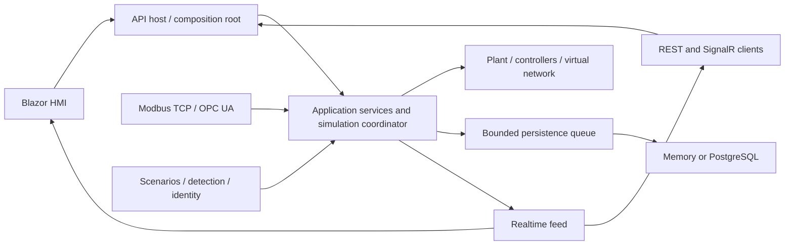

# SCADA cybersecurity training simulator

A .NET 10 simulator for learning industrial process operation, cyberattack detection and incident response. It models a three-tank water treatment plant, PLCs/RTU, a segmented virtual network, safety interlocks and process alarms. **Simulation only: never connect it to physical industrial equipment.**

Features include 14 scripted scenarios, 17 detection rules, an incident workflow with evidence and timelines, a live Blazor HMI, REST and SignalR interfaces, optional Modbus TCP and OPC UA, cookie/API-key/optional OIDC authentication, and in-memory or EF Core/PostgreSQL storage.



## Quick start: in memory

Install the .NET 10 SDK and run from the repository root:

```bash
dotnet restore scada.slnx
DOTNET_ENVIRONMENT=Development dotnet run --project src/Api -- --urls http://127.0.0.1:5080
```

Open <http://127.0.0.1:5080/> and sign in. Development creates `dev-viewer`, `dev-operator` and `dev-admin` with random passwords and API keys in the gitignored, owner-readable `.scada/dev-credentials.txt`. Read it locally; do not commit or share it. Memory storage resets on process restart. Other environments do not generate these accounts.

| Role | Access |
| --- | --- |
| Viewer | Observe the plant, alarms, trends, events, incidents and scenario results |
| Operator | Viewer access plus device commands, alarm acknowledgement, simulation pause/step and incident handling |
| Administrator (instructor) | Operator access plus scenarios, ground truth, simulation reset, controller/network controls, accounts and rule tuning |

## Quick start: PostgreSQL with Compose

Generate separate local secrets and start the stack:

```bash
mkdir -p .scada
(umask 077; for key in POSTGRES_PASSWORD SCADA_VIEWER_KEY SCADA_OPERATOR_KEY SCADA_ADMIN_KEY; do
  printf '%s=%s\n' "$key" "$(openssl rand -hex 32)"
done > .scada/compose.env)
docker compose --env-file .scada/compose.env -f deploy/compose.yaml up --build -d
curl --fail http://127.0.0.1:5080/health/ready
```

This stack exposes HTTP on loopback port 5080 and PostgreSQL on loopback port 5432; data uses a named volume. Shared role keys authenticate scripts through `X-Api-Key`; they do not supply browser passwords. For HMI sign-in, seed a named account or enable the optional Keycloak stack as described in [deployment](docs/deployment.md). No default production password exists.

## HMI and protocols

The HMI covers overview, plant diagram, tanks, pumps, valves, sensors, PLC/RTU, communications, registers, alarms, trends, events, incidents/detail, scenarios, accounts/rules, identity and system health. See [page permissions and live behavior](docs/hmi.md).

Both external protocols are disabled by default. Modbus binds to `127.0.0.1:1502`; OPC UA binds to `127.0.0.1:4840`. OPC UA anonymous access and automatic certificate acceptance both default to `false`. [Protocol details](docs/protocols.md)

## Development checks

```bash
dotnet build scada.slnx -c Release --disable-build-servers
dotnet test scada.slnx -c Release --no-build
```

The full test command includes PostgreSQL Testcontainers and requires Docker. [Testing](docs/testing.md) lists every test project, the Playwright setup and the CI jobs. `bash scripts/verify.sh` restores, builds and tests the solution.

## Documentation

- [Architecture](docs/architecture.md), [REST and SignalR API](docs/api.md), [configuration reference](docs/configuration.md)
- [User guide](docs/user-guide.md), [HMI pages](docs/hmi.md), [scenarios](docs/scenarios.md), [incidents](docs/incidents.md)
- [Security](docs/security.md), [protocols](docs/protocols.md)
- [Deployment](docs/deployment.md), [operations runbook](docs/operations.md), [PostgreSQL](docs/postgresql.md), [observability](docs/observability.md), [testing](docs/testing.md)
