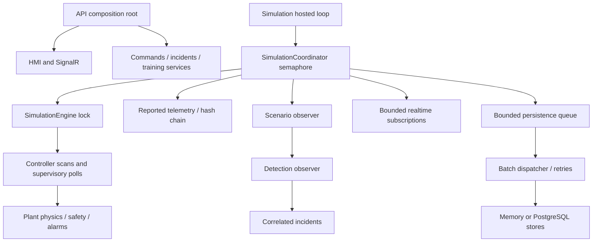

# Architecture

The solution is a modular .NET 10 monolith hosted by `src/Api`. Domain state and simulation services are singletons: run one active simulator host per training environment. A shared database does not coordinate multiple simulation loops.

## Projects and dependency rules

| Project | Responsibility | Allowed project dependencies |
| --- | --- | --- |
| Domain | Plant physics, devices, alarms/interlocks, controllers/registers, network and incident state machine | None |
| Application | Commands, simulation coordination, historian, incident services and persistence/realtime abstractions | Domain |
| Security | Authentication, account administration, command monitoring, detection and scenarios | Application, Domain |
| Infrastructure | Memory and EF Core/PostgreSQL stores, persistence/retention workers and realtime broadcaster | Application, Domain |
| Protocols | Modbus TCP and OPC UA adapters over application services | Application, Domain |
| Simulation | Hosted loop, state/rule recovery, initial scenario and topology loading | Security, Application, Domain |
| Hmi | Blazor interactive server components and per-circuit identity/view | Security, Application, Domain |
| Api | Composition root, HTTP auth/middleware, endpoint groups, SignalR and hosting | All above |

`Tests/ArchitectureTests` enforces dependencies and keeps ASP.NET Core/database drivers out of Domain, Application, Security and Simulation. Source rules enforce one named public/internal type per file, matching file/type names and namespaces, and no explicit `void` except framework overrides; Razor code is checked too. EF-generated migrations are excluded where appropriate. `Directory.Build.props` enables nullable reference types and warnings as errors. Shared state uses `System.Threading.Lock`; services obtain UTC time through `TimeProvider`.

## Simulation loop

`SimulationService` ticks every `Simulation:StepSeconds / Simulation:TimeScale` wall seconds: by default 0.5 / 5 = 100 ms. This is a target cadence; awaited observer work can make it slower. Validation prevents a period below 5 ms. `Simulation:Host:RunLoop=false` lets tests or REST callers drive steps explicitly. A paused loop skips normal steps; manual stepping forces advancement.

`SimulationEngine` owns the world under one lock. Each step accumulates controller scans, reads field I/O over the virtual network, applies latched controller fail-safe decisions, polls supervisory links, then steps plant physics, interlocks, instruments and alarms. The default seed is 1337. Controllers execute automatic loops; operator commands normally require Manual mode. The network models link latency, loss, timeout, zones and permitted conduits without sending real attack traffic.

`SimulationCoordinator` serializes step/distribution with a semaphore. After releasing the engine lock it translates process events, queues alarm history, samples the historian every 2 steps and queues a state checkpoint every 20 steps. Observers execute sequentially: scenario actions, detection, then optional OPC UA publication. Scenario mutations therefore exist when detection runs, although a step report captures the state before observer actions. Observer exceptions are logged and isolated. Scenario actions use simulated time; several event-detection windows use wall time.

## Commands and observers

`ControlCommandService` applies role, rate, sequence/replay and network-path checks before plant mutation, then audits the result. REST, HMI, OPC UA and scenario commands share this service. Register setpoint access has its own bounds/role/write-enable checks. Instructor training controls deliberately inject faults or network impairment.

`ScenarioEngine` runs one scheduled scenario at a time, records actions/measurements and evaluates expected versus observed rule IDs. `DetectionEngine` evaluates 17 rules, deduplicates findings, saves detections and raises/merges incidents by correlation key. During scenarios the key scopes evidence to the run. Incident writes, scenario records, account operations and rule settings use their stores directly: database latency can delay these observers and operations even though high-volume persistence is queued.

## Realtime and HMI

`RealtimeBroadcaster` implements `IRealtimePublisher` and `IRealtimeFeed`. Each subscriber has its own bounded DropOldest channel; publication never waits for a slow reader. HMI components use 64-message subscriptions and normally refresh at most every 250 ms. They re-read services, rather than render arbitrary message payloads. Blazor runs in interactive server mode without prerendering.

`RealtimeHubForwarder` subscribes with capacity 1024 and sends `Realtime(topic, payload)` to `/hubs/scada` clients. `GetSnapshot` supplies initial/recovery state. Plant snapshots are redacted for Viewers/Operators in REST, HMI and SignalR; Administrators see ground truth. OPC UA always uses operator measurement values. See [HMI](hmi.md) and [API](api.md) for the limits of redaction and delivery.

## Persistence and recovery

`ChannelPersistenceQueue.TryEnqueue` never blocks. Capacity defaults to 10,000 work items; a full queue rejects the incoming item and increments `Dropped`. This differs from the realtime feed, which drops oldest messages. The worker takes batches of 256, groups by work-item type, dispatches groups concurrently and retries failures up to 3 total attempts with linear 200 ms backoff. Exhausted groups increment `Failed`; they are not retained for later replay. State work items in one group coalesce to the newest snapshot. Graceful shutdown gives the queue a five-second drain window.

Events, telemetry batches, alarm history and simulation checkpoints use this queue in both storage modes. Events enter a recent buffer and realtime immediately; paged event queries can lag until persistence completes. The live historian holds 20,000 total samples; durable telemetry is queried separately.

Startup applies migrations (unless disabled), seeds configured accounts and optionally creates development accounts before accepting requests. Hosted recovery loads rule settings and the newest compatible simulation checkpoint before the loop. State recovery includes plant snapshots, controller state/setpoints and pause state; it does not resume an active scenario, restore the live historian window or reproduce every transient network/force state. The recovery service saves final state on graceful shutdown. Retention runs on startup and hourly for the four registered targets. [PostgreSQL details](postgresql.md)
