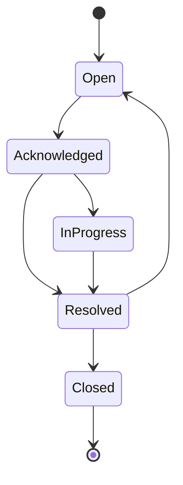

# Incidents

Detection findings create incidents through `IncidentService`, rather than a background monitor scanning SecurityAlert events. Each detection retains rule/evidence metadata and a linked incident ID. New findings merge into an active incident with the same correlation key: `scenario:{runId}` during a scenario, otherwise category plus device/rule. Duplicate evidence references are not attached twice. Merging can raise severity and add affected devices. Water and grid detection both raise through the same `IncidentService`, so the shared incidents page and `/api/incidents` list incidents of both modes (filter by `scenarioRunId` for a specific scenario run).

Incidents have UUID IDs, human numbers such as `INC-00042`, category/severity/priority, assignment, affected devices, scenario linkage, evidence, timeline, comments, resolution notes and an optimistic `version`. PostgreSQL allocates numbers from `scada.incident_number_seq`.

## Workflow



Only these transitions are allowed. Resolution requires nonblank notes; notes/comments are limited to 4000 characters. Moving to InProgress assigns the actor if no assignee exists. Reopening clears resolution actor/time. Closed is terminal and disallows reassignment, priority edits and comments. Active-only queries exclude Resolved and Closed.

All roles can query incidents/details/timeline. Operator or higher can change status, assignment, priority and comments. The HMI confirms edits, captures the displayed version and refreshes on conflicts. REST status/assignment/priority accept optional `expectedVersion`; service/store concurrency checks still protect updates when it is omitted. REST comments accept only `text`.

```http
POST /api/incidents/{id}/status
Content-Type: application/json
X-Api-Key: <operator-key>

{"status":"Acknowledged","expectedVersion":1}
```

Resolve an Acknowledged or InProgress record with `{"status":"Resolved","notes":"Cause identified and training defaults restored","expectedVersion":2}` using its actual current version. Use the returned version for the next edit. The server records the authenticated actor, not a supplied label.

Mutations return IncidentChange: 200 success, 400 invalid input, 404 missing incident and 409 lifecycle/concurrency conflict; authentication/rate/CSRF errors apply separately. [Complete endpoint/query reference](api.md#incidents)

Both stores keep timeline and comments separately from the incident record; PostgreSQL changes survive restart. Incidents and their workflow history are not covered by the automatic age-retention worker. [Trainee workflow](user-guide.md#investigate-an-incident)
